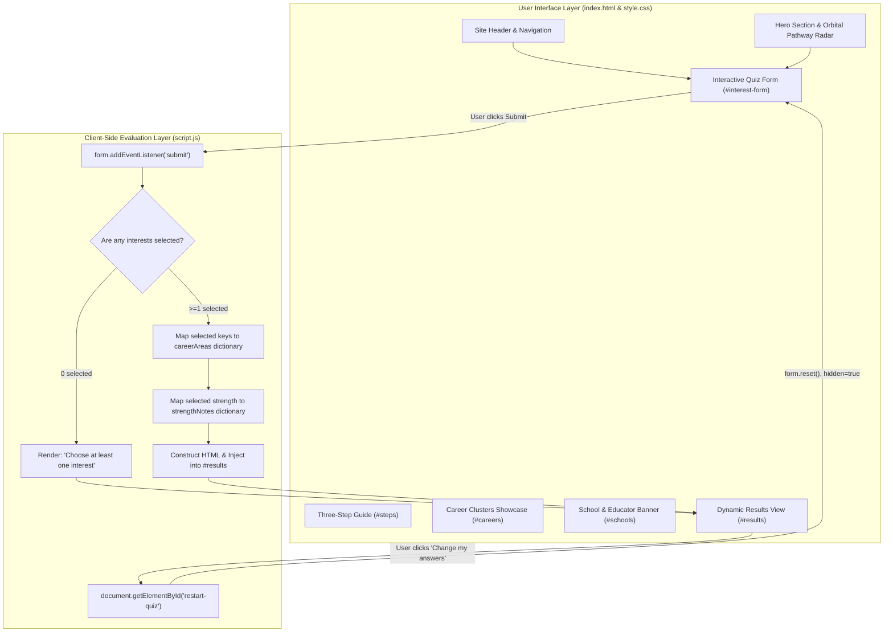

# Project_OyeHoye — Career & Pathway Explorer

> **Discover what sparks your future.** An open, client-side career exploration platform designed to help students map interests and problem-solving strengths to practical career pathways, actionable first steps, and educational directions—with zero logins, zero data collection, and zero algorithmic pressure.

---

## Project Overview

**Project_OyeHoye** is a lightweight, responsive web application built to facilitate self-guided career discovery for high school students, university learners, and educators. 

Rather than prescribing a singular "ideal career" based on opaque algorithms, the application acts as an exploratory compass. Users select the fields and activities that genuinely interest them, identify their natural problem-solving strengths, and immediately receive transparent, curated pathway clusters accompanied by concrete, bite-sized next steps they can take today.

- **Target Audience:** High school students exploring higher education or vocational options, undergraduate learners seeking direction, career counsellors, teachers, and parents facilitating career discussions.
- **Delivery Model:** 100% client-side web application running directly in any modern web browser without dependencies, external database connections, or mandatory registration.

---

## Problem Statement

Navigating modern career options can be overwhelming and stressful for young learners:

- **Premature Specialization:** Students are often forced to choose specific university majors or career paths before understanding what daily work in those disciplines looks like.
- **High-Stakes Pressure & Ranking Anxiety:** Many traditional career tests generate intimidating numerical rankings, aptitude scores, or definitive predictions that increase anxiety rather than encourage curiosity.
- **Privacy Intrusion & Paywalls:** Several commercial assessment platforms require user registration, track personal data, or hide meaningful guidance behind paywalls.
- **Lack of Immediate Next Steps:** Students frequently encounter broad academic titles (e.g., "Data Scientist" or "UX Designer") without practical guidance on low-risk activities they can try immediately to test their interest.

---

## Our Solution

Project_OyeHoye solves these challenges through an open, pressure-free exploratory model:

- **Interest-Driven Multi-Select:** Allows users to choose multiple interest areas simultaneously, acknowledging that modern careers are frequently interdisciplinary.
- **Strengths Reflection:** Pairs interest domains with a reflection on how the individual naturally approaches challenges (analytical, supportive, creative, or methodical).
- **Actionable Micro-Steps:** Every recommended pathway comes paired with a concrete, accessible "Small Next Step" (such as building a simple webpage, planning a small event, or interviewing a trusted adult).
- **Privacy-by-Design:** All recommendation and matching logic executes entirely client-side via JavaScript. No personal information or quiz responses are ever stored or transmitted.
- **Balanced Career Clusters:** Features six curated macro-clusters providing a high-level overview of available domains across arts, sciences, business, people, technology, and trades.

---

## Key Features

### Implemented Features Summary

| Feature | Description | Implementation Details |
| :--- | :--- | :--- |
| **Site Navigation Header** | Responsive header with brand identity, smooth anchor navigation, and quick-action CTA button. | Semantic `<header>`, Flexbox, smooth scrolling anchors. |
| **Interactive Pathway Hero & Radar** | Dynamic hero section with title, value propositions, trust row, and an orbital pathway visualizer card. | CSS Grid, absolute positioning, CSS border-radius and dashed rings (`.orbit`, `.orbit-ring`). |
| **Three-Step Process Guide** | Overview outlining the 3-phase methodology: Select Interests, Discover Pathways, and Take Action. | CSS Grid (`.steps-grid`), custom icon badges, card hover animations. |
| **Multi-Select Interest Form** | Interactive checkbox form allowing users to select 1 to 6 interest areas. | Semantic `<fieldset>`, `<input type="checkbox">`, custom focus and `:checked` styling. |
| **Strength Assessment Selector** | Single-choice radio group capturing the user's preferred problem-solving style. | Semantic `<fieldset>`, `<input type="radio">`, custom accent color. |
| **Client-Side Recommendation Engine** | Instant evaluation mapping selected inputs to curated domain summaries and micro-actions. | Vanilla JavaScript dictionary lookups (`careerAreas`, `strengthNotes`). |
| **Dynamic Results Panel** | Form-adjacent panel displaying matched clusters, strength insights, guidance disclaimer, and reset control. | JavaScript DOM template injection, `results.hidden` toggle, smooth scrolling. |
| **Form Validation & Recovery** | Client-side validation alerting users if form is submitted with zero interests selected. | Conditional DOM rendering (`<h3>Choose at least one interest</h3>`). |
| **Quiz Reset Workflow** | Single-click mechanism to clear inputs, hide results, and smoothly return to the start of the form. | `form.reset()`, `#restart-quiz` event handler, `scrollIntoView`. |
| **Six Core Career Clusters** | Dedicated visual showcase of 6 career clusters with unique color palettes and iconography. | CSS Grid (`.career-grid`), 6 palette variants (`.blue`, `.green`, `.pink`, `.purple`, `.yellow`, `.orange`). |
| **Educator & Classroom Banner** | Highlighted section tailored for schools, teachers, and career advisors conducting classroom sessions. | High-contrast container (`.school-banner`), list callouts, and classroom launch CTA. |
| **Responsive Mobile Layout** | Adaptive styling optimized for desktop (1200px+), tablet (<=800px), and mobile screens (<=520px). | CSS `@media` queries with single-column collapse and scaled orbit graphics. |

---

## How It Works

### The User Journey

```
1. Browse Overview  ──>  2. Complete Quiz  ──>  3. Generate Insights  ──>  4. Take Action or Reset
   - Explore Hero         - Select 1+ interests    - View matched fields     - Try suggested micro-step
   - Review 3 Steps       - Select 1 strength      - Read strength note      - Click "Change my answers"
   - Inspect Clusters     - Click "See My Ideas"   - Read advisory notice    - Explore related clusters
```

### The Recommendation Logic

The application relies on deterministic client-side evaluation defined in [`script.js`](file:///Users/sarakottawar/Project_OyeHoye/script.js):

1. **Submission Interception:** An event listener on `#interest-form` intercepts `submit` events and invokes `event.preventDefault()` to eliminate page refreshes.
2. **Selection Gathering:**
   - Active checkboxes with `name="interest"` are collected using `form.querySelectorAll('input[name="interest"]:checked')` and mapped to their value keys (`technology`, `people`, `creative`, `science`, `business`, `practical`).
   - Active radio selection with `name="strength"` is captured using `form.querySelector('input[name="strength"]:checked')`.
3. **Validation Check:**
   - If zero interests are selected, `#results` is revealed with a prompt instructing the user to choose at least one activity before re-submitting.
4. **Data Retrieval:**
   - The selected interest keys map directly to records inside the `careerAreas` dictionary object:
     - `title`: Name of the career cluster.
     - `description`: Educational disciplines, subject combinations, and industry scope.
     - `action`: A low-friction, immediate micro-step to explore the field.
   - The strength key maps to a corresponding entry in `strengthNotes`.
5. **DOM Generation & Viewport Management:**
   - Result cards are assembled as an HTML string using template literals and injected into `#results`.
   - The `hidden` property on `#results` is set to `false`.
   - `results.scrollIntoView({ behavior: "smooth", block: "start" })` smoothly centers the user's viewport on the generated results.
6. **State Reset:**
   - Clicking `#restart-quiz` invokes `form.reset()`, restores `results.hidden = true`, and scrolls smoothly back to the top of `#interest-form`.

---

## Technology Stack

Project_OyeHoye is built entirely with standard web technologies, deliberately avoiding bulky third-party frameworks or build steps for maximum speed, portability, and simplicity.

| Layer | Technology | Version / Specification | Purpose |
| :--- | :--- | :--- | :--- |
| **Markup** | HTML5 | Living Standard | Semantic document structure, accessible form controls, SEO metadata. |
| **Styling** | Vanilla CSS3 | Modern CSS | Custom CSS variables (`:root`), CSS Grid, Flexbox, transitions, media queries. |
| **Typography** | Google Fonts | Web API | `DM Sans` (body and button text) and `Manrope` (headings and branding). |
| **Behavior** | Vanilla JavaScript | ECMAScript 2020+ (ES6+) | Form handling, DOM query/manipulation, dynamic HTML injection, scroll control. |
| **Licensing** | MIT License | Standard | Open-source distribution terms. |

---

## Project Structure

```
Project_OyeHoye/
├── index.html        # Main HTML5 document containing all semantic sections and form controls
├── style.css         # Complete stylesheet: design tokens, layout grids, components, media queries
├── script.js         # Client-side quiz evaluation, dynamic DOM rendering, and reset logic
├── LICENSE           # Standard MIT open-source license text
└── README.md         # Comprehensive project documentation
```

### File Responsibilities

- **[`index.html`](file:///Users/sarakottawar/Project_OyeHoye/index.html):** Defines the complete webpage layout, including the site navigation header, hero section with the orbital radar, 3-step explanation, quiz form, career cards, school advisory banner, and footer.
- **[`style.css`](file:///Users/sarakottawar/Project_OyeHoye/style.css):** Contains all design rules, color palette tokens, typography rules, component layouts, state transitions, and responsive breakpoints (`@media (max-width: 800px)` and `@media (max-width: 520px)`).
- **[`script.js`](file:///Users/sarakottawar/Project_OyeHoye/script.js):** Houses the knowledge dictionary (`careerAreas` and `strengthNotes`), form validation, submit event handler, dynamic markup generation, and state reset listeners.
- **[`LICENSE`](file:///Users/sarakottawar/Project_OyeHoye/LICENSE):** Contains the official MIT License specifying terms of use, copyright, and distribution.

---

## Installation and Setup

Because Project_OyeHoye uses pure vanilla web technologies, there are no package managers (`npm`/`yarn`), build tools, or compilers required.

### Prerequisites

All you need is a modern web browser:
- Google Chrome, Mozilla Firefox, Apple Safari, or Microsoft Edge.
- Git (optional, for cloning the repository).

### Quick Start (Running Locally)

#### Option A: Direct Browser Launch (Simplest)
1. Clone or download the repository to your local computer:
   ```bash
   git clone https://github.com/pagoll-glitch/Project_OyeHoye.git
   cd Project_OyeHoye
   ```
2. Double-click [`index.html`](file:///Users/sarakottawar/Project_OyeHoye/index.html) or open it directly in your browser:
   - On macOS:
     ```bash
     open index.html
     ```
   - On Linux:
     ```bash
     xdg-open index.html
     ```
   - On Windows:
     ```powershell
     start index.html
     ```

#### Option B: Local HTTP Server via Python
Running via a local HTTP server ensures smooth asset loading and mimics a live hosting environment:
```bash
# If using Python 3:
python3 -m http.server 8000
```
Then navigate to `http://localhost:8000` in your browser.

#### Option C: VS Code Live Server Extension
1. Open the `Project_OyeHoye` directory in Visual Studio Code.
2. Install the **Live Server** extension (by Ritwick Dey).
3. Right-click [`index.html`](file:///Users/sarakottawar/Project_OyeHoye/index.html) and select **"Open with Live Server"**.

---

## How to Use

Follow these steps to navigate the platform and explore career ideas:

1. **Explore the Overview:**
   - Use the navigation bar links (`How It Works`, `Explore Paths`, `Career Areas`, `For Schools`) to scroll to key sections.
   - Review the three-step framework to understand the discovery approach.
2. **Complete Question 1 (Interests):**
   - In the **Interest Explorer** section, select one or more checkbox options matching your genuine curiosity:
     - Technology & Data
     - People & Society
     - Creative Fields
     - Science & Environment
     - Business & Leadership
     - Practical & Skilled Work
3. **Complete Question 2 (Strengths):**
   - Select the radio button corresponding to your preferred problem-solving method:
     - Analytical & Logical
     - Supportive & Empathetic
     - Creative & Innovative
     - Organised & Methodical
4. **Generate Recommendations:**
   - Click the **"See My Career Ideas →"** button.
   - The page smoothly scrolls to the results panel displaying:
     - Curated summaries for each selected interest area.
     - A concrete **"Small next step"** activity for immediate exploration.
     - A **"Strength reflection"** callout matching your problem-solving style.
     - A practical advisory reminder encouraging discussions with mentors.
5. **Adjust or Reset Choices:**
   - Click **"Change my answers ↻"** to clear the form, hide the results, and smoothly scroll back to the top of the form for another session.

---

## Architecture Overview

The following diagram illustrates how the components, styles, data structures, and DOM events interact in Project_OyeHoye:



---

## Screenshots and Demo

> *Note: Placeholders below can be populated with actual screenshots or video walkthroughs.*

### Desktop Interface Preview
```
+--------------------------------------------------------------------------+
|  ✦ OyeHoye        How It Works    Explore Paths    Career Areas    Take Quiz |
+--------------------------------------------------------------------------+
|                                                                          |
|  CAREER & PATHWAY EXPLORATION                +-------------------------+ |
|  Discover what sparks your future.           |  LIVE PATHWAY RADAR     | |
|                                              |         ( 💻 )          | |
|  Explore career pathways, match interests    |   ( 🔬 ) [ YOU ] ( 🎨 ) | |
|  with real-world roles, and take confident   |         ( 🤝 )          | |
|  steps toward your goals.                    +-------------------------+ |
|                                                                          |
|  [ Start Exploration -> ]  See how it works                              |
+--------------------------------------------------------------------------+
```

### Live Demo Placeholder
- **Live Deployment:** *[Insert Live Deployment Link Here — e.g., GitHub Pages / Netlify / Vercel]*
- **Video Walkthrough:** *[Insert Demo Video Link Here]*

---

## Current Limitations

Based on a strict inspection of the current codebase, the project currently has the following limitations:

- **Static Content Dictionaries:** Career information and strength notes are hardcoded directly inside [`script.js`](file:///Users/sarakottawar/Project_OyeHoye/script.js). They do not dynamically update from an external API or database.
- **Session-Only State:** Choices and generated recommendations are not persisted in `localStorage` or `sessionStorage`. Reloading the page resets all inputs.
- **Fixed Question Set:** The questionnaire comprises exactly two questions (interest multi-select and strength single-select). There are no deep branched sub-questions.
- **No Export Functionality:** Results cannot be directly exported as a PDF or sent via email from within the UI (though users can use browser print functionality).
- **English Only:** All interface text and career guidance data are currently provided only in English.

---

## Future Enhancements

The following features represent planned improvements for future iterations (clearly distinguished from implemented functionality):

- [ ] **Data Externalization:** Move career definitions and strength notes into a dedicated `data/careers.json` file for easier community contributions and localization.
- [ ] **Local Storage Persistence:** Allow users to save their results locally to revisit later without creating an account.
- [ ] **Printable PDF Export:** Add a dedicated "Download Summary" button that formats the user's matched pathways into a clean, printable PDF report.
- [ ] **Expanded Career Pathways:** Increase the number of curated micro-steps and add detailed sub-pathway links to accredited vocational and university syllabi.
- [ ] **Multilingual Support:** Implement language toggles (e.g., Hindi, Spanish, French) to make career exploration accessible to non-English-speaking students.
- [ ] **Dark / Light Theme Toggle:** Provide a customizable visual theme switch.

---

## Testing and Validation

Project_OyeHoye does not currently use an automated testing framework (such as Jest or Cypress). Instead, quality assurance is maintained through manual verification across key user flows:

### Manual Test Matrix

| Test Case | Steps to Test | Expected Behavior |
| :--- | :--- | :--- |
| **Empty Submission Validation** | Click "See My Career Ideas" without selecting any interest checkboxes. | The results panel displays `Choose at least one interest` and scrolls into view without console errors. |
| **Single Interest Selection** | Check "Technology & Data", select "Analytical & Logical", click Submit. | Results panel displays the Technology & Data card, the Analytical reflection, advisory disclaimer, and restart button. |
| **Multiple Interest Selection** | Check 3 different interest checkboxes, select a strength, click Submit. | Results panel dynamically renders all 3 corresponding career cards in order, followed by the selected strength note. |
| **No Strength Selected** | Check 1 interest checkbox, leave all radio buttons unselected, click Submit. | Results panel renders the chosen career card and advisory note cleanly without rendering an empty strength box. |
| **Form Reset Flow** | Click "Change my answers ↻" after viewing results. | All checkboxes and radio buttons uncheck, the results panel hides (`hidden=true`), and the page smoothly scrolls to the top of the form. |
| **Anchor Link Navigation** | Click each header navigation link (`#steps`, `#quiz`, `#careers`, `#schools`). | The viewport scrolls smoothly to the target section with the correct header offset. |
| **Responsive Viewport Test** | Resize browser from 1440px down to 375px. | Navigation bar hides on mobile, grids adapt from 3 columns to 1 column, and form elements remain legible. |

---

## Contributing Guidelines

Contributions, bug reports, and suggestions are welcome! To contribute:

1. **Fork the Repository:** Create your own fork of the project on GitHub.
2. **Clone Your Fork:**
   ```bash
   git clone https://github.com/<your-username>/Project_OyeHoye.git
   cd Project_OyeHoye
   ```
3. **Create a Feature Branch:**
   ```bash
   git checkout -b feature/add-new-career-pathway
   ```
4. **Make and Test Your Changes:**
   - Keep styles consistent with existing CSS custom properties in [`style.css`](file:///Users/sarakottawar/Project_OyeHoye/style.css).
   - Verify that form inputs and dictionary keys remain synchronized in [`index.html`](file:///Users/sarakottawar/Project_OyeHoye/index.html) and [`script.js`](file:///Users/sarakottawar/Project_OyeHoye/script.js).
   - Test your changes manually across desktop and mobile viewports.
5. **Commit Your Changes:**
   ```bash
   git commit -m "feat: add sustainable agriculture to science pathways"
   ```
6. **Push and Open a Pull Request:**
   ```bash
   git push origin feature/add-new-career-pathway
   ```
   Open a pull request describing the changes made and the rationale behind them.

---

## Git and Team Collaboration

To maintain code quality and avoid synchronization conflicts, follow these collaborative practices:

### Essential Git Commands

```bash
# Check current repository status and modified files
git status

# Create and switch to a new branch for your task
git checkout -b feature/<feature-name>

# Stage modified files
git add index.html style.css

# Commit changes with a descriptive, conventional message
git commit -m "style: enhance mobile padding for quiz section"

# Pull the latest updates from main before pushing
git checkout main
git pull origin main
git checkout feature/<feature-name>
git merge main

# Push your branch to the remote repository
git push origin feature/<feature-name>
```

### Collaboration Best Practices
- **Write Meaningful Commit Messages:** Use clear prefixes (e.g., `feat:`, `fix:`, `docs:`, `style:`, `refactor:`) explaining *why* a change was made.
- **Never Force Push to Shared Branches:** Avoid running `git push --force` or `git push -f` on `main` or other shared branches, as this overwrites teammate history.
- **Keep Branches Focused:** Restrict each branch to a single feature or bug fix to simplify code reviews.

---

## License

This project is licensed under the **MIT License**.

```
MIT License

Copyright (c) 2026 pagoll-glitch

Permission is hereby granted, free of charge, to any person obtaining a copy
of this software and associated documentation files (the "Software"), to deal
in the Software without restriction, including without limitation the rights
to use, copy, modify, merge, publish, distribute, sublicense, and/or sell
copies of the Software, and to permit persons to whom the Software is
furnished to do so, subject to the following conditions:

The above copyright notice and this permission notice shall be included in all
copies or substantial portions of the Software.

THE SOFTWARE IS PROVIDED "AS IS", WITHOUT WARRANTY OF ANY KIND, EXPRESS OR
IMPLIED, INCLUDING BUT NOT LIMITED TO THE WARRANTIES OF MERCHANTABILITY,
FITNESS FOR A PARTICULAR PURPOSE AND NONINFRINGEMENT. IN NO EVENT SHALL THE
AUTHORS OR COPYRIGHT HOLDERS BE LIABLE FOR ANY CLAIM, DAMAGES OR OTHER
LIABILITY, WHETHER IN AN ACTION OF CONTRACT, TORT OR OTHERWISE, ARISING FROM,
OUT OF OR IN CONNECTION WITH THE SOFTWARE OR THE USE OR OTHER DEALINGS IN THE
SOFTWARE.
```

Refer to the official [`LICENSE`](file:///Users/sarakottawar/Project_OyeHoye/LICENSE) file for complete details.

---

## Acknowledgements

- **Contributors:**
  - **pagoll-glitch** (Sara Kottawar) — Project maintainer, frontend styling, layout design.
  - **Parth** — Initial markup and structure.
  - **daprachinegi** — Quiz logic, evaluation handler, and dataset curation.
- **Typography:**
  - [DM Sans](https://fonts.google.com/specimen/DM+Sans) designed by Colophon Foundry (Google Fonts).
  - [Manrope](https://fonts.google.com/specimen/Manrope) designed by Mikhail Sharanda (Google Fonts).
- **Standards:**
  - Built following standard W3C semantic HTML5 and modern CSS best practices.

---

## Project Links and Contact

- **GitHub Repository:** [https://github.com/pagoll-glitch/Project_OyeHoye](https://github.com/pagoll-glitch/Project_OyeHoye)
- **Issue Tracker:** [https://github.com/pagoll-glitch/Project_OyeHoye/issues](https://github.com/pagoll-glitch/Project_OyeHoye/issues)
- **Live Demo:** *[Insert Live Demo Link when deployed]*
- **Maintainer Contact:**
  - GitHub: [@pagoll-glitch](https://github.com/pagoll-glitch)
  - Email: `kottawarsara@gmail.com`